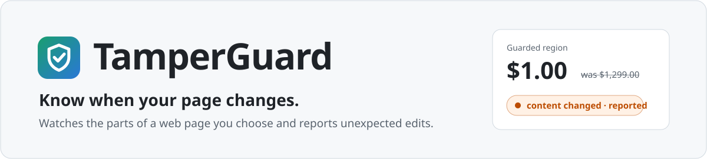
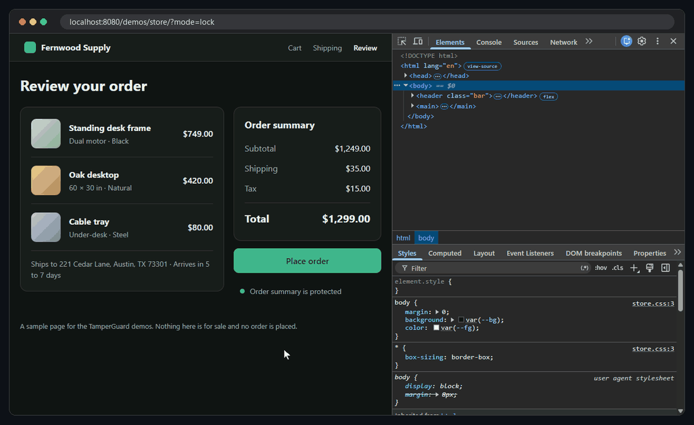
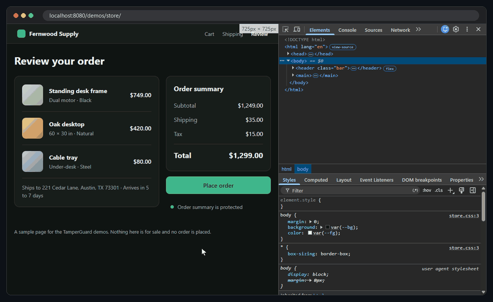

<p align="center">
  <picture>
    <source media="(prefers-color-scheme: dark)" srcset="assets/banner-dark.svg">
    
  </picture>
</p>

<p align="center">
  <a href="https://github.com/ammar-saleh/tamperguard/actions/workflows/ci.yml"></a>
  
  <a href="LICENSE"></a>
</p>

TamperGuard watches the parts of a web page you choose and tells you when they change.

Anyone can open developer tools, change a price on the page and take a screenshot. A browser extension can swap text or cover content. TamperGuard notices and reports it. If you ask it to, it locks the page.

It is a first layer, not a security boundary. Anyone who controls the browser can turn it off, so keep real checks (prices, permissions, payments) on your server.

<p align="center">
  
</p>
<p align="center"><sub>Recorded in Chrome with real DevTools, on the sample store page in <code>demos/store</code>.</sub></p>

## More demos

**Lock mode: one line in the console, and the page is replaced**



**Changed and put back in the same instant. Still caught**


**A fake total laid over the real one**


**Hidden with a style rule, markup untouched**



## Good for, not for

| Good for | Not for |
| --- | --- |
| Noticing casual edits such as "Inspect element, change the price, screenshot" | Proving a screenshot is authentic |
| Flagging injected overlays, swapped text or hidden content in a region you choose | Stopping a determined user, a debugger or an extension with full access |
| Finding out what changed a part of the page, and when | Authorizing payments, scores or account changes |

## Quick start

TamperGuard is not on npm yet. Install it from GitHub:

```sh
npm install github:ammar-saleh/tamperguard
```

```js
import TamperGuard from 'tamperguard';

const guard = new TamperGuard({
  selector: '[data-guard]',
  mode: 'report',                       // or 'lock'
  onTamper(detail) {
    console.log(detail.type, detail.reason);
  }
}).start();
```

```html
<section data-guard>
  <strong>$1,299.00</strong>
</section>
```

Without a bundler, copy `dist/tamperguard.min.js` to your site and load it with a script tag. It defines a global `TamperGuard`.

It has no dependencies, needs no backend, and sends nothing over the network unless you set a `reportUrl`. It works in Chrome and Edge 93+, Firefox 92+ and Safari 15.4+.

## Before you deploy

Run in report mode first. Most surprises come from your own page.

1. **Start it after your third-party scripts.** Analytics and error-monitoring tools wrap browser functions, and the guard reports that.
2. **Check what your app does to `<html>` and `<body>`.** Dark-mode classes and scroll locks count as changes unless you set `watchAncestors: false`.
3. **Guard small, static regions.** Typing in a guarded form field counts as a change.
4. **Accept your own changes** with `update()` or `rebaseline()`.
5. **Lock mode erases the page** and any unsaved work.

## Docs

| Document | What it covers |
| --- | --- |
| [API reference](docs/API.md) | Options, lifecycle, events, lock mode, the hardened `protect()` factory |
| [Coverage matrix](docs/COVERAGE.md) | Exactly what is and is not detected |
| [Security model](SECURITY.md) | Assumptions, limits, how to report a vulnerability |
| [Frameworks](docs/FRAMEWORKS.md) | React and Vue |
| [Performance](docs/PERFORMANCE.md) | What each check costs |

## Run the demos

```sh
git clone https://github.com/ammar-saleh/tamperguard.git
cd tamperguard
npm ci
npm run build
npm run serve
```

Open http://127.0.0.1:8080/demos/ and try it with your own DevTools.

## Tests

Every change runs on Chromium, Firefox and WebKit. See the [verification record](docs/VERIFICATION.md).

```sh
npx playwright install chromium firefox webkit
npm run check
```

## License

[MIT](LICENSE) © Ammar Saleh. Security issues: see [SECURITY.md](SECURITY.md). Contributions: see [CONTRIBUTING.md](CONTRIBUTING.md).
