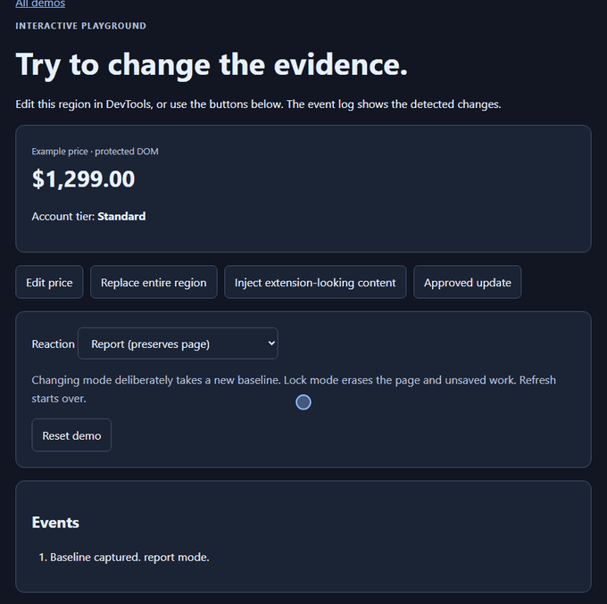

<p align="center">
  <picture>
    <source media="(prefers-color-scheme: dark)" srcset="assets/banner-dark.svg">
    
  </picture>
</p>

<p align="center">
  <a href="https://github.com/ammar-saleh/tamperguard/actions/workflows/ci.yml"></a>
  
  <a href="LICENSE"></a>
</p>

TamperGuard watches the parts of a web page you choose and tells you when they change unexpectedly.

Anyone can open the browser's developer tools, change a price or a balance on the page, and take a screenshot. A browser extension can swap text or cover content. TamperGuard notices these edits as they happen and reports them. **Reporting is the default.** Locking the page is an explicit, opt-in reaction.

It is a **first layer**: a local tamper signal and deterrent, not a security boundary. Anyone who controls the browser can turn it off. Keep real validation (prices, permissions, transactions) on your server.

<p align="center">
  
</p>
<p align="center"><sub>The playground demo. A guarded price is edited and reported, then edited again in lock mode.</sub></p>

| Good for | Not for |
| --- | --- |
| Noticing casual edits such as "Inspect element → change the price → screenshot" | Proving a screenshot is authentic |
| Flagging injected overlays, swapped text or hidden content in a region you choose | Stopping a determined user, a debugger or a browser extension with full access |
| Diagnostics: "what changed this DOM region, and when?" | Authorizing payments, scores or account changes |
| Demonstrating and teaching client-side tampering | Replacing CSP, SRI or server-side checks |

It runs entirely in the page, has no dependencies, needs no backend, and sends nothing over the network unless you configure a `reportUrl`.

## Quick start

TamperGuard is not on npm yet. Until it is, install it from GitHub:

```sh
npm install github:ammar-saleh/tamperguard
```

```js
import TamperGuard from 'tamperguard';
// CommonJS also works: const TamperGuard = require('tamperguard');

const guard = new TamperGuard({
  selector: '[data-guard]',
  mode: 'report',
  onTamper(detail) {
    console.log(detail.type, detail.reason, detail.targetId);
  }
}).start();
```

```html
<section data-guard>
  <h2>Example price</h2>
  <strong>$1,299.00</strong>
</section>
```

Without a bundler, copy `dist/tamperguard.min.js` from this repository to your own site. It defines a global `TamperGuard`. Start once the protected DOM exists:

```html
<script src="/js/tamperguard.min.js"
        integrity="sha384-REPLACE-WITH-VALUE-FROM-dist/integrity.json"
        crossorigin="anonymous" defer></script>
<script type="module">
  // Module scripts run after parsing, so the guarded elements exist.
  const guard = new TamperGuard({ selector: '[data-guard]' }).start();
</script>
```

Copy the `integrity` value from `dist/integrity.json`, which lists the size and SHA-384 hash of each build.

The package supports ESM, CommonJS, a browser global, and TypeScript (NodeNext). Importing or constructing it during SSR is safe; `start()` needs a live browser document.

## Before you deploy

TamperGuard cannot tell a benign change from a malicious one, so most surprises come from your own page. Go through this list in **report mode** before turning on lock mode.

1. **Start after third-party scripts.** By default the guard records selected browser APIs at start and reports an `environment` violation if one is replaced later. Error-monitoring, analytics and session-replay SDKs often wrap APIs such as `addEventListener`, `setInterval` or input value setters. Initialize those first, then start the guard, or set `watchEnvironment: false`. Detection keeps running after an `environment` violation, but `rebaseline()` and `update()` refuse to accept a new baseline until the APIs are restored. To recover, `destroy()` the guard and start a new one.
2. **Check `<html>` and `<body>` attributes.** Ancestor attribute changes count as tampering (`watchAncestors: true`), because hiding a region through its parent is a common trick. Modals that add `overflow: hidden` to `<body>`, dark-mode classes on `<html>`, and language switches all trigger it. If your app does this, set `watchAncestors: false`. Moving or replacing the region is still detected.
3. **Guard small, static regions.** Typing in a guarded form field counts as a change. Choose stable selectors (IDs or `data-*` markers), not `:hover` or `:focus`.
4. **Accept your own changes explicitly.** Wrap approved DOM updates in `update()` or call `rebaseline()` after a known commit. See [framework integration](docs/FRAMEWORKS.md) for React and Vue.
5. **Lock mode erases the page.** Unsaved work is lost and a refresh is required. Measure false positives with real users' extensions, translation, autofill and themes first.

Read the [coverage matrix](docs/COVERAGE.md) for exactly what is and is not detected, and [SECURITY.md](SECURITY.md) for the threat model.

## Hardened local integration

Use `TamperGuard.protect()` for separate frozen monitor/controller handles, mutation-history checks and stylesheet inspection. Keep the controller in module scope; share only the monitor. The factory rejects a telemetry endpoint.

```js
const { monitor, controller } = TamperGuard.protect({ mode: 'report' });
console.log(monitor.getStatus());
// For a static screen only: controller.seal();
```

`seal()` permanently blocks stop, destroy and baseline acceptance on that instance until reload. It does not enable lock mode by itself. For the sealed lock example, tradeoffs and bypass boundaries, read [local hardening](docs/HARDENING.md). Native private state and frozen public objects protect ordinary property access; they cannot defeat privileged debugging or script blocking.

## Detection and behavior

- Observes text, attributes, children, target removal/replacement, target-set changes, movement through ancestors, and ancestor attributes.
- Preserves significant whitespace; snapshots without cloning custom elements or using collision-prone hashes.
- Checks input, textarea, select, and option state. User input inside a guarded region triggers a check; programmatic changes rely on a sweep or `check()`.
- Traverses open shadow roots inside guarded targets. A known closed shadow root may be supplied as an explicit `root`.
- Optionally checks readable stylesheet rules, disabled/media state, imports, and adopted stylesheets.
- Optionally inspects mutation history, including edit-and-restore and identical-markup replacements; enabled by `protect()`.
- Audits selected browser API descriptors for post-start replacement by default, and keeps inspecting content afterwards. Optional visibility sampling detects some external overlays.
- Uses mutation records to resnapshot affected regions; nested selected targets are covered once. Periodic checks remain a full backstop.
- Continues reporting changed anomalous states without accepting them as a new trusted baseline. An unchanged anomaly is not emitted on every sweep.

A `targets` violation means the original set was removed, replaced, reordered, or expanded. Replacement targets are **not automatically trusted or continuously content-baselined**. Restore the original elements or explicitly accept the new set with `rebaseline()`.

Detection runs after DOM mutation delivery or on a timer, not before a script executes. Pixel-only changes and inaccessible browser state remain outside coverage. Strict mutation history covers observed transient DOM changes; restored property/CSSOM changes can still be missed. Visibility sampling covers some overlays, not all visual changes.

## Reference

| Document | What it covers |
| --- | --- |
| [API reference](docs/API.md) | Every option, the lifecycle methods, events and telemetry, lock mode |
| [Coverage matrix](docs/COVERAGE.md) | Exactly what is and is not detected |
| [Security model](SECURITY.md) | Assumptions, what a violation means, how to report a vulnerability |
| [Local hardening](docs/HARDENING.md) | `protect()`, sealing, and their limits |
| [Framework integration](docs/FRAMEWORKS.md) | React and Vue |
| [Performance](docs/PERFORMANCE.md) | What each check costs and how to tune it |

## Browser support

Requires ES2022 (native private fields and `Object.hasOwn`): Chrome/Edge 93+, Firefox 92+, Safari 15.4+. Every release is tested on current Chromium, Firefox and WebKit through Playwright. Playwright WebKit is not a substitute for testing on physical Safari/iOS devices.

## Try the demos

```sh
git clone https://github.com/ammar-saleh/tamperguard.git
cd tamperguard
npm ci
npm run build
npm run serve
```

Open **http://127.0.0.1:8080/demos/**. The playground, attack matrix, hardened demo and React/Vue examples use locally built assets and make no CDN requests.

## Verification and performance

```sh
npx playwright install chromium firefox webkit
npm run check          # build, Node/package contracts, types, three browser engines
npm run pack:check     # pack and install into a clean temporary consumer
npm run benchmark      # reproducible synthetic measurements
```

CI runs the same checks on every push and pull request. The browser suite covers private-state and sealed-controller resistance, transient mutation history, API replacement, optional occlusion sampling, detection, intentionally excluded cases, lifecycle, reporting failures, CSP/Trusted Types, and offline demos. See [verification results](docs/VERIFICATION.md), [performance methodology](docs/PERFORMANCE.md), and the [release checklist](docs/RELEASING.md).

## Positioning and prior work

DOM monitoring is established prior art. [DOMtegrity](https://github.com/toreini/DOMtegrity) explores a different, server-assisted protocol and threat model. [disable-devtool](https://github.com/theajack/disable-devtool) focuses on restricting developer tools. TamperGuard's focus is a small, inspectable, scoped monitor with lifecycle control, explicit acceptance, and reproducible browser tests. It does not claim to supersede those systems or defeat browser owners.

## Contributing and security

Contributions are welcome; see [CONTRIBUTING.md](CONTRIBUTING.md). Each behavior change needs a regression test and a precise statement of coverage. Please report vulnerabilities privately as described in [SECURITY.md](SECURITY.md), not in public issues.

[MIT](LICENSE) © Ammar Saleh
